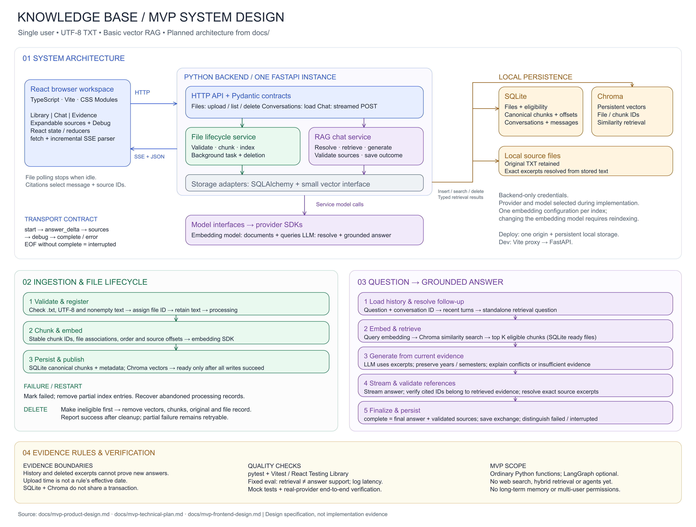

# MVP System Design Diagram

Open [the editable Excalidraw diagram](mvp-system-design.excalidraw) using **Open** in [Excalidraw](https://excalidraw.com/). Use **Zoom to fit** to see all sections, then zoom in to read or edit individual components.

The diagram is the original architectural design; current behavior and verification are documented in the module guides and release report. Ingestion now waits within the upload request, and source text is retained in SQLite chunks rather than separate TXT copies. It is based on the [product design](mvp-product-design.md), [technical plan](mvp-technical-plan.md), and [frontend design](mvp-frontend-design.md).

The four sections cover:

1. System architecture: React, FastAPI, services, model interfaces, SQLite, Chroma, and retained TXT files.
2. Ingestion and file lifecycle: validation, chunking, embeddings, readiness, failure recovery, and deletion.
3. Question answering: follow-up resolution, eligible retrieval, grounded generation, source validation, streaming, and persistence.
4. Evidence boundaries, verification requirements, and MVP scope.

Arrows in the architecture section show dependencies and the primary request/response direction; storage reads return through the same adapters. The lower workflows expand the service behavior. The model interface box represents service calls through provider SDKs; storage adapters do not invoke models.

SQLite controls retrieval eligibility, and only ready files can supply evidence. SQLite and Chroma do not share a transaction. Source-ID validation checks reference membership; it does not prove answer support. Retrieval scores are not correctness probabilities. The diagram itself is not validation evidence; use the recorded tests and live-provider reports linked from the documentation index.
