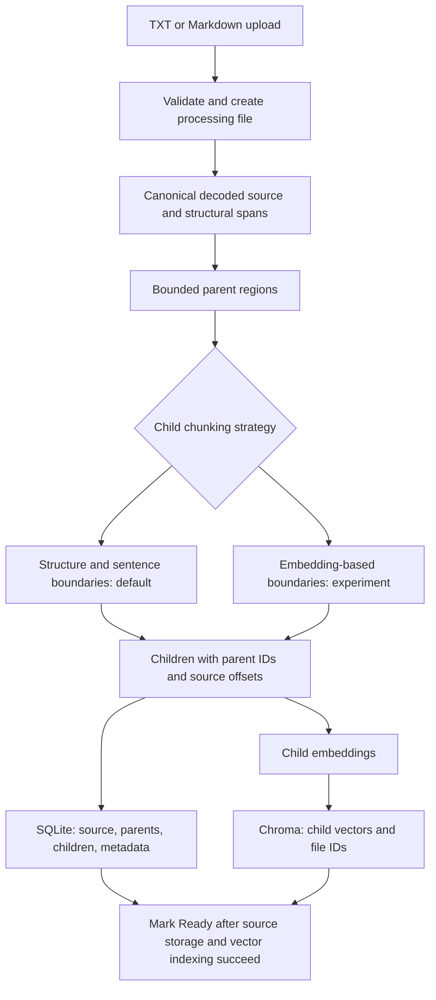
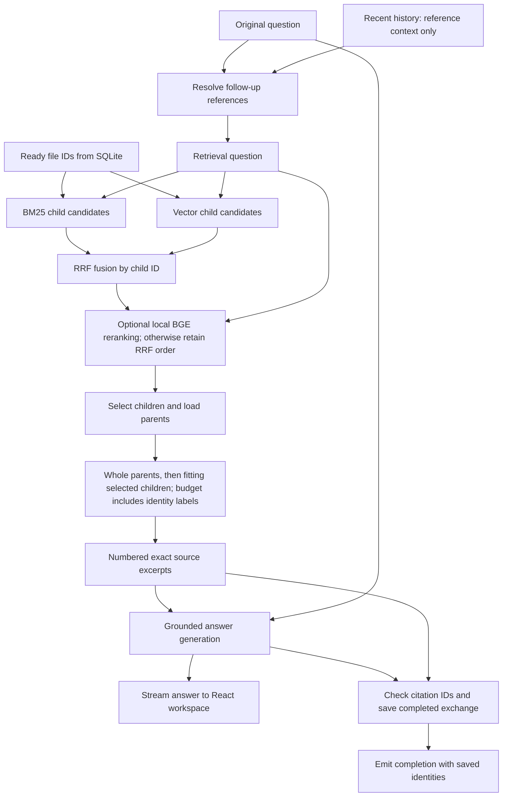

# KnowledgeBase v1 System Design

Status: the structural parent-child and hybrid retrieval paths are implemented.
Semantic child boundaries are implemented as an opt-in experiment. Reranking and
packing improvements are on `v1` awaiting user acceptance. See the
[version status](README.md) for merge boundaries; diagrams do not establish quality.

## Ingestion

Canonical source text and exact spans live in SQLite. Derived index text and
embeddings aid search without replacing evidence. Parsing and chunking are backend
modules, not separate deployed services. BM25 reads Ready canonical children from
SQLite for each query, with no separate persisted lexical index. Ingestion failure
keeps the file ineligible and triggers vector and partial-record cleanup.

## Retrieval and Answering

If no evidence survives selection, return the existing insufficient-evidence result
without answer generation. Stream cancellation and interruptions keep partial text
out of persisted conversation history. A committed answer can survive a lost
completion event, as in the MVP.

## Boundaries and Ownership

| Component | Owns |
| --- | --- |
| React workspace | Uploads, chat state, stream handling, evidence navigation, optional diagnostics |
| FastAPI and services | Request translation, file lifecycle, query orchestration, completed-answer persistence |
| RAG steps | Chunk boundaries, lexical/vector candidate coordination, RRF, parent selection, context packing |
| Provider adapters | Embeddings, relevance reranking, generation, and follow-up resolution |
| SQLite | Canonical source, parent/child relations, eligibility, conversations, evidence snapshots |
| Search indexes | Lexical postings/statistics and child embeddings derived from canonical records |
| Evaluation runner | Isolated indexes, labeled configurations, stage traces, saved outputs, comparisons |

Model placement depends on the selected provider; a reranker need not be remote.
Credentials remain on the backend. Deletion excludes a file first, then removes
both indexes and canonical records while retaining saved answer snapshots.

For record contracts and implementation sequence, see the
[technical plan](v1-technical-plan.md). For quality claims and release evidence,
see the [evaluation plan](v1-evaluation-plan.md).
