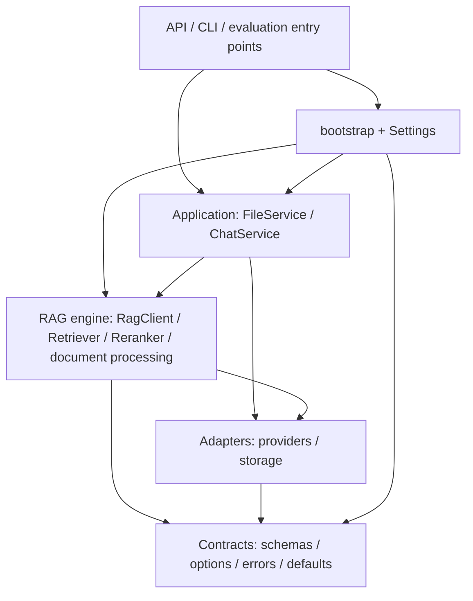

# Layered Architecture and Independent Components

This is the current import and ownership contract after the 2026-10-01 OOP
follow-up. It supersedes the module destinations in the original
[OOP plan](oop-refactoring.md). The starting revision is `3d7d7dd`; the previous
[dependency audit](../../evals/check-runs/20261001-dependency-audit/README.md)
identified a chunking cycle and runtime-configuration coupling.

## Design reference

The requested references are Pi Agent Book
[chapter 1](https://dg-ai-notes.pages.dev/modules/ch01-overview/) and
[chapter 2](https://dg-ai-notes.pages.dev/modules/ch02-three-layer-arch/).
Their useful principle here is independent reuse with dependencies directed
toward lower layers. An upper layer may import a lower layer directly, including
shared types; adjacency is not the requirement.

The upstream manifests also show the direction:
[agent core](https://github.com/earendil-works/pi/blob/main/packages/agent/package.json)
depends on AI, while
[coding agent](https://github.com/earendil-works/pi/blob/main/packages/coding-agent/package.json)
depends on both. These moving upstream references are design context, not runtime
dependencies of KnowledgeBase. This project uses Python modules within one
distribution; it does not introduce independently published packages.

## Dependency direction

Arrows mean "imports or calls a lower-level component."



The reusable stack has three responsibility bands: application workflows, RAG
engine, and adapters/contracts. The bootstrap and entry points compose that
stack. The frontend communicates over HTTP/SSE and has no Python imports.
Each band can use lower public contracts directly.

| Boundary | Contents | Permitted first-party dependencies |
| --- | --- | --- |
| Defaults | `defaults.py` | None |
| Contracts | `schemas/`, including `options.py` and `errors.py` | Defaults, other schemas |
| Providers | Embedding, LLM, streaming, planner and reranker clients | Defaults, schemas, other providers |
| Storage | SQLite records/operations, ChromaStore, PdfAssets, storage lifecycle | Defaults, schemas, other storage modules |
| RAG engine | `rag/`: document processing, retrieval, ranking, planning and answer generation | Defaults, schemas, providers, storage, other RAG modules |
| Application services | `services/`: FileService and ChatService | Defaults, schemas, providers, storage, RAG, other services |
| Runtime configuration | `config.Settings` | Defaults and schemas |
| Composition | `bootstrap.AppResources`, `build_resources` | Runtime configuration and the reusable stack |
| Entry points | API startup, CLI, active evaluation runners | Composition and the reusable stack |

All intra-boundary dependencies must also be acyclic. Providers and storage are
peers and do not import each other. Nothing in the reusable stack imports
`config`, `bootstrap`, `api`, `cli`, `main` or evaluation entry points. HTTP route
handlers use services and schemas; `api/app.py` owns startup, and
`api/dependencies.py` exposes assembled resources.

## Concrete changes

| Before | Current location or responsibility | Reason |
| --- | --- | --- |
| `rag.chunking.DocumentChunker` | `rag.document_chunker.DocumentChunker` | The dispatcher depends on basic and semantic splitters; basic splitters never import the dispatcher |
| `services.rag.RagClient` | `rag.client.RagClient` | The reusable answer engine belongs below application workflows |
| `services.hops.HopController` | `rag.hops.HopController` | Multi-hop execution is part of the RAG engine |
| `services.planning.RequestControl` and `PreparedPlanning` | `rag.planning` | Request-local engine control must not depend on application services |
| Defaults and pure options mixed into `config.py` | `defaults.py` and `schemas/options.py` | Components do not import the environment loader |
| `FileService.from_settings` | Explicit FileService/parser/chunker construction in `bootstrap.py` | Settings interpretation belongs to composition |
| HTTP route imports a storage exception | `schemas.errors.FileRecordNotFoundError` | Error contract shared without importing storage implementation |

`config.py` still imports options and defaults to define Settings; existing
top-level configuration consumers can access those names there. Reusable
components import their owning modules directly. No old-path dispatcher or RAG
service re-export is retained. Historical experiment scripts remain at their
recorded revisions; active callers and tests use the new paths.

The chunking DAG is now:

```text
DocumentChunker -> semantic_chunking -> chunking
               -> chunking
               -> PDF chunk/evidence helpers
```

## Classes and independent use

| Component | Public operations | What the caller supplies |
| --- | --- | --- |
| DocumentParser | `prepare`, `parse` | Bytes and filename; optional LocalPdfParser for PDF |
| DocumentChunker | `split` | Parsed File and explicit chunk settings; embeddings only for semantic splitting |
| Reranker | `rerank` | Candidate records and a scoring client |
| Retriever | `retrieve`, `retrieve_candidates`, `retrieve_plan`, `pack` | Embeddings, store, options, optional reranker; a read session per operation |
| RagClient | `answer`, `stream` | Session factory, retriever, LLM; optional streaming/planner clients |
| ChatService | `answer`, `stream`, `get_conversation` | RagClient, session factory, optional follow-up resolver |
| FileService | `ingest`, `delete`, `recover`, `list_files`, `get_file`, `get_original` | Session factory, store, embeddings and optional parser/chunker/PDF assets |
| EmbeddingClient | `embed_documents`, `embed_query`, `bounded` | Caller-owned SDK client and model |
| LLMClient / StreamingLLMClient | `generate` / `stream`, `bounded` | Caller-owned SDK client and model |
| PlannerClient | `plan`, `structured` | SDK client, model, pure PlanningOptions and tokenizer; HopController uses structured calls for binding/assessment |
| RerankerClient | `score` | Model, device and batch/token limits |
| ChromaStore | `upsert_chunks`, `search`, `delete_by_file_id` | Caller-owned Chroma collection |
| PdfAssets / LocalPdfParser / PdfParser | Asset operations / lazy parse / extraction | Local paths and PDF dependencies when used |
| AppResources / Settings | Assembly / environment resolution | Used by entry points, never required by standalone components |

Independent use means the caller supplies the dependencies required by the
selected operation. A model call still needs a model client; retrieval still
needs an index. It does not require starting the web app, creating AppResources,
loading `.env`, or importing application services to run the RAG engine.
One installed project environment is still used; splitting installation extras
or publishing separate SDKs is outside this change.

This complete example runs locally without credentials, HTTP or storage:

```python
from knowledgebase.rag.document_chunker import DocumentChunker
from knowledgebase.rag.parsing import DocumentParser

content = b"# Hours\n\nAlpha closes at five.\n"
parser = DocumentParser()
document = parser.parse(parser.prepare("hours.md", content), content)
chunks, indexing = DocumentChunker(chunking_strategy="parent_child").split(document)
assert chunks.children
for chunk in chunks.children:
    assert chunk.text == document.text[chunk.start_offset:chunk.end_offset]
    print(chunk.chunk_id, chunk.text)
```

For an existing index, construct
`RagClient(sessions, Retriever(embeddings, store), llm)` and call `answer` or
`stream` directly. RagClient returns results/events without saving conversations;
ChatService adds that application behavior. Reranker accepts candidates directly
without an index or RagClient. The
[standalone tests](../../tests/test_standalone_layers.py) contain complete offline
examples for all three bands, including a real temporary SQLite/Chroma index.

## Ownership and enforcement

Entry points own SDK and storage lifetimes. Bootstrap maps Settings into explicit
constructor arguments and calls recovery while the storage lock is held. Storage
initialization never imports FileService or triggers business recovery.
Reusable instances hold dependencies; sessions, plans, cancellation and answers
stay local to a request. Parsing/tokenization/retrieval algorithms, prompt text,
HTTP/SSE contracts and persistent schema are unchanged by this structural move.

Run `make test-architecture` for the architecture checks, which are also included
in `make test`:

- Parse all production Python modules, `main.py` and active evaluation modules;
  reject cycles and forbidden layer edges, including function-local and
  `TYPE_CHECKING` imports. Literal absolute dynamic imports are included;
  computed dynamic imports require an explicit audit.
- In fresh processes, block imports of upper layers before importing a component.
  Run contracts, provider calls with a fake SDK, all four chunk strategies and
  reranking, real temporary storage, RAG without services, and services without
  runtime configuration/bootstrap/API/CLI. Remove OpenAI environment variables
  and use a working directory with no `.env`.
- Compare frozen HTTP outputs, schemas, model inputs, evidence, streaming events
  and saved history with the same offline fixture used before the change.

The static graph covers explicit source imports, not arbitrary reflection or
third-party internals. Package initialization is exercised by the fresh-process
checks. PDF/model execution retains its own component tests and required local
dependencies; fake provider checks do not measure live model quality or billing.

Verification results, failed attempts and measurement limits are retained in
the [implementation report](../../evals/check-runs/20261001-layered-architecture/README.md).
