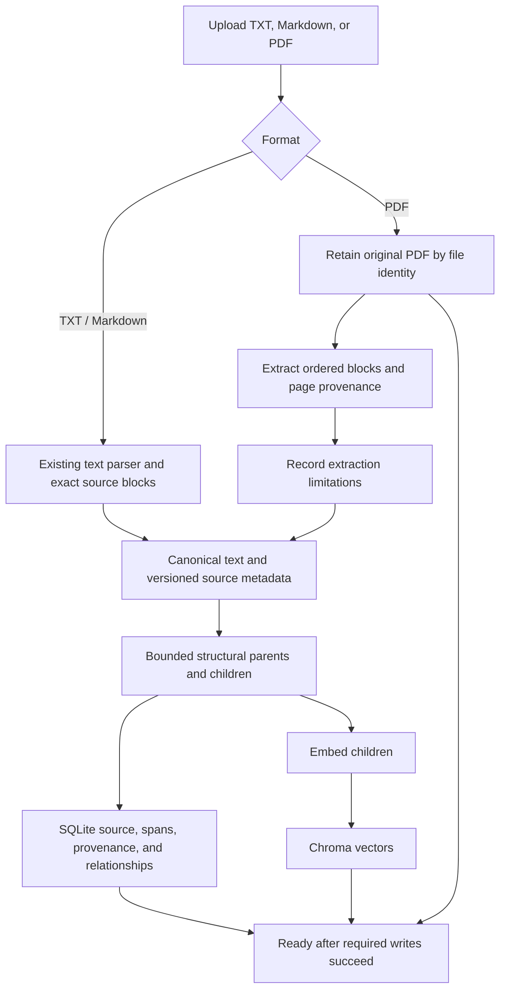
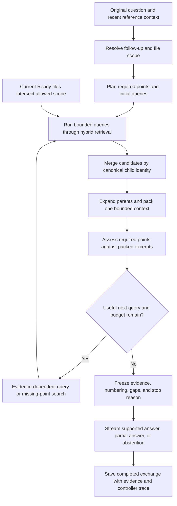

# KnowledgeBase v2 System Design

Status: architecture implemented for the v2 functional closeout, reusing existing
v1 components. See the [release summary](release-summary.md) for acceptance evidence
and the remaining parser/model limits.

## Ingestion

The asset dependency applies to PDFs only. The parser adapter returns application
records; downstream retrieval does not depend on a parser vendor's internal types.
BM25 continues to use eligible canonical children; this plan adds no separate
lexical server. Extraction failures and cleanup use the existing file lifecycle.

## Bounded Question Workflow

The direct route traverses Search once. Decomposition can search independent
requirements in that round. Multi-hop retrieval derives a later target from
earlier evidence. Sufficiency-driven supplementary retrieval targets a remaining
gap. They share one controller budget, not nested retry loops.

Planning/search/checking progress events are separate from answer deltas. Only
the final evidence set is numbered for user-visible citations. Cancellation or
errors exit without saving an incomplete exchange. Preserve the existing behavior
where a successfully committed answer may outlive a lost completion event.

## State and Ownership

| State | Owner | Retention |
| --- | --- | --- |
| Original PDF | Local asset storage coordinated by file service | Until deletion; no hidden historical asset copy |
| Extracted source and locations | SQLite source records | Live source lifetime; extraction identity is versioned |
| Parents/children and vectors | SQLite and Chroma | Rebuilt for affected extraction/index settings; excluded before deletion |
| Active plan, queries, and candidates | Chat service request | Bounded request state; relevant trace saved on completion |
| Exact final excerpts and page metadata | Answer snapshot | Survives source deletion and later reindexing |
| Controller trace and usage | Versioned answer diagnostics | Saved with the completed answer when recorded |
| Failed experiment evidence | Append-only evaluation run | Retained separately; not a partial user conversation |

SQLite, the filesystem, and Chroma are separate persistence boundaries. Extend
the current single-process data-directory ownership and cleanup/recovery rules.
Original-file reads resolve a live file ID; they do not expose filesystem paths.

The entire library remains local, but configured embedding and language-model
providers may receive text as in v1. A local PDF parser does not make remote
generation offline. This plan introduces no new remote document service.

## Core Invariants

- A chunk belongs to one source revision; its excerpt is an exact canonical slice.
- PDF locations map to original pages; extracted offsets are not PDF byte offsets.
- Only eligible files within allowed scope can enter any retrieval round.
- Derived queries may use sourced findings; intermediate model prose is not evidence.
- Requirement checks apply to packed context, including budget losses.
- All rounds share finite query, model-call, context, and time allowances.
- Final citations refer to saved excerpts actually supplied to generation.
- History restores saved evidence; deletion disables original PDF viewing.

See the [technical plan](v2-technical-plan.md) for controller semantics and the
[evaluation plan](v2-evaluation-plan.md) for how to verify each boundary.
